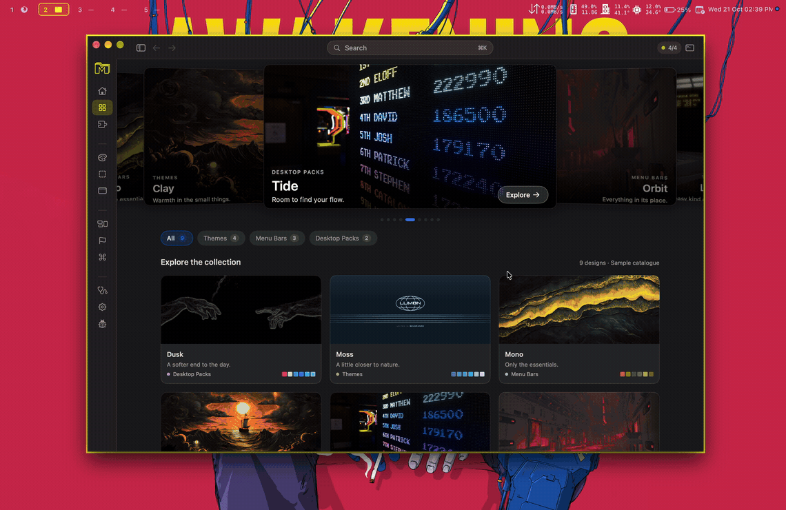

  

<h1 align="center">Macarchy</h1>

<strong>Your Mac. Your desktop.</strong> A themed, tiling desktop for macOS, managed in one native app.

  
  
  

  <a href="#get-started">Get started</a> ·
  <a href="CONTRIBUTING.md">Contributing</a> ·
  <a href="https://github.com/HarryRandall/macarchy/issues">Report a problem</a>

  
   Theme switching across the desktop, shown with custom wallpapers.

## Make it yours

- **One theme, across your desktop.** Match your menu bar, window borders,
  Ghostty and wallpaper. Eight palettes included, with support for your own.
- **Windows where you want them.** Tiling, spacing, app rules and shortcuts
  from a native settings window.
- **A bar you can edit.** Arrange items, adjust spacing and preview changes.
- **Your setup stays yours.** Keep existing dotfiles or start fresh. Setup
  backs them up so you can restore them later.

Built around [yabai](https://github.com/asmvik/yabai),
[skhd](https://github.com/asmvik/skhd),
[SketchyBar](https://github.com/FelixKratz/SketchyBar) and
[JankyBorders](https://github.com/FelixKratz/JankyBorders).

## Get started

**Early preview · Apple Silicon · macOS 26+ · SIP stays on**

[Build and install from source →](CONTRIBUTING.md#build-and-install)
Requires Xcode 27 and Homebrew. Prebuilt releases are not available yet.

Open Macarchy to set up your desktop, then use **⌘⌃Space** to switch themes.
Add your own wallpapers to complete the look; wallpapers are not bundled.

For setup, shortcuts and configuration, see the
[configuration reference](CONTRIBUTING.md#configuration-reference).
To undo setup, use **Advanced → Restore original files** before deleting the app.

Star history

<a href="https://www.star-history.com/#HarryRandall/macarchy&amp;Date">
  <picture>
    <source media="(prefers-color-scheme: dark)" srcset="https://api.star-history.com/svg?repos=HarryRandall/macarchy&amp;type=date&amp;theme=dark">
    <source media="(prefers-color-scheme: light)" srcset="https://api.star-history.com/svg?repos=HarryRandall/macarchy&amp;type=date">
    
  </picture>
</a>

---

[GPL-3.0](LICENSE) · [Credits](CREDITS.md) · Inspired by [Omarchy](https://github.com/basecamp/omarchy)
